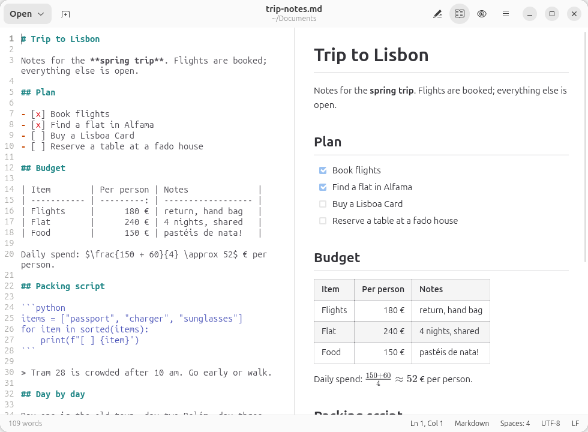
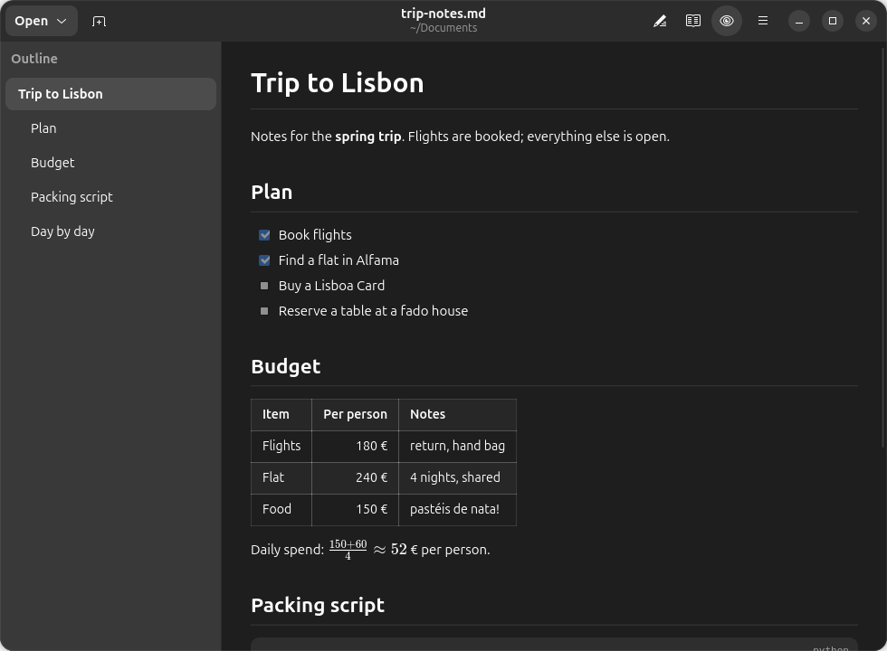
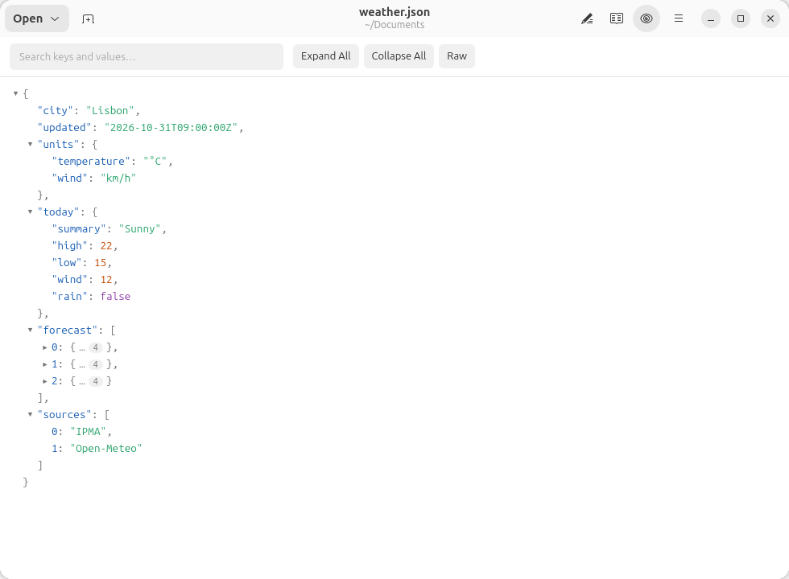
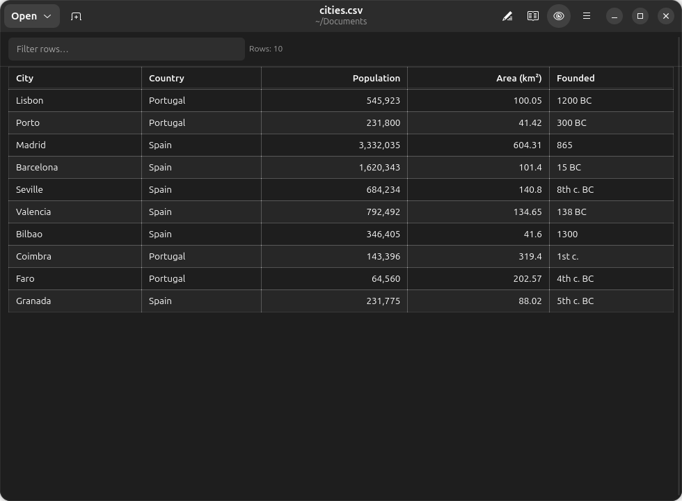

# Verso

A text editor for GNOME that shows what your files look like while you write them. Built with GTK 4, libadwaita, GtkSourceView and WebKitGTK.



## Features

- **Markdown** rendered like on GitHub: tables, task lists, highlighted code, footnotes, definition lists, front matter, KaTeX math and Mermaid diagrams
- **Edit, Preview, or both Side by Side** (Ctrl+E switches), with synchronized scrolling
- **Outline** of the headings (F9) to move around long documents
- **Writing helpers**: lists and quotes continue on Enter, Ctrl+B / Ctrl+I / Ctrl+K for bold, italic and links, Ctrl+Shift+I aligns tables, a URL pasted over text becomes a link, a pasted image is saved next to the file
- **JSON, YAML, TOML and XML** as a collapsible, searchable tree that keeps the order of the file; also JSON with comments (`tsconfig.json`, `.jsonc`), JSON Lines (`.jsonl`) and INI-style files (`.ini`, `.env`, `.editorconfig`, systemd units)
- **CSV and TSV** as a table you can sort and filter
- **HTML and SVG** previews; HTML runs without scripts
- Preview themes (GitHub, Document, Reader), print and export to PDF
- Unsaved changes are kept as drafts: they survive closing Verso, a crash or a restart
- Encodings, line endings and indentation per document; files changed on disk are noticed
- Tabs, find and replace, go to line, spell checking, overview map, dark mode, session restore
- Works offline: KaTeX and Mermaid ship with the app, the preview never loads anything from the network

| | |
|---|---|
|  |  |
|  | |

## Keyboard shortcuts

| Shortcut | Action |
|---|---|
| Ctrl+E | Switch between edit and preview |
| F9 | Show or hide the outline (Esc returns to the text) |
| Ctrl+B / Ctrl+I / Ctrl+` | Bold / italic / code (Markdown) |
| Ctrl+K | Insert a link (Markdown) |
| Ctrl+Shift+I | Format JSON, or align the Markdown table at the cursor |
| Ctrl+F / Ctrl+H | Find / find and replace |
| Ctrl+L | Go to line |
| Ctrl+P | Print |
| Ctrl+T, Ctrl+W | New tab, close tab |
| Ctrl+? | All shortcuts |

## Running from the source tree

Verso is heading to Flathub; until then it runs from the source tree. Ubuntu 26.04 needs:

```
sudo apt install gir1.2-webkit-6.0 gir1.2-gtksource-5 gir1.2-spelling-1 \
                 python3-markdown-it python3-pygments python3-yaml meson gettext
sudo apt install python3-mdit-py-plugins   # optional: footnotes and definition lists
```

```
./bin/verso file.md      # run without installing (compiles schema and translations into .dev/)
./install.sh             # meson install into ~/.local, default app for .md and .json
./uninstall.sh
```

## Tests

```
python3 -m pytest tests -q                         # unit tests
meson test -C _build                               # desktop file, MetaInfo, schema, install list
GSETTINGS_SCHEMA_DIR=.dev/schemas GSETTINGS_BACKEND=memory tools/headless.sh python3 tests/ui_smoke.py   # real window in an invisible GNOME Shell
```

`tools/screenshots.sh` regenerates the screenshots in `data/screenshots/` the same way.

## Translations

Translations live in `po/`; Polish is complete and serves as the reference. To update the template after changing strings: `meson compile -C _build verso-pot verso-update-po`.

## Roadmap

See [ROADMAP.md](ROADMAP.md).

## License

MIT
